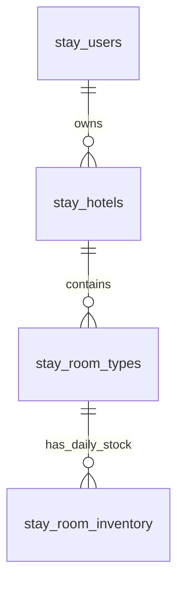

# 酒店、房型與每日庫存

| 表格 | 主要欄位／規則 |
| --- | --- |
| `stay_hotels` | `host_id`、名稱、唯一 slug、描述、地址、城市、ISO 國家／貨幣代碼、酒店時區、狀態 |
| `stay_room_types` | `hotel_id`、酒店內唯一的房型 code、名稱、描述、每間最多入住人數、床數、實際總房數、基本每晚價格、是否啟用 |
| `stay_room_inventory` | `room_type_id`、日期、當日總房數、已訂數、封鎖數、當晚價格、停售開關 |

使用 `stay_` 前綴，不共用舊專案的 `users`、`hotels` 或其他表格。三層外鍵採限制刪除，避免誤刪父資料。酒店只能由 `HOST` 建立持有；此角色規則由 Java 建構程式檢查，資料庫外鍵只保證帳號存在。Admin 管理 API 之後再加。

## 庫存怎麼計算

可售房數 = `total_rooms - booked_rooms - blocked_rooms`；不額外存一份可能過期的 available 欄位。停售日無論剩幾間都不可預訂。已訂＋封鎖不可超過當日總房數，且價格與數量不可為負值；這些規則由資料庫 CHECK 再次保護。

每日總房數也不得超過房型的實際總房數。這是跨表規則，透過 `RoomInventory.configure` 檢查，不能只依靠 MySQL CHECK。既有 API 尚未開放直接寫入這些 Entity。

同房型同日期以唯一鍵保護。每晚可以設定不同價格；建立缺少的庫存時才從房型基本價格複製，之後不會自動覆寫當日價格。貨幣由酒店統一指定，金額使用 `DECIMAL(12,2)`／`BigDecimal`，不使用浮點數或默默四捨五入；目前固定最多兩位小數，不做匯率轉換。

`stay_date` 以酒店當地日期儲存（`DATE`／`LocalDate`），酒店另存 IANA 時區，例如 `Asia/Kuala_Lumpur`；建立／更新時間使用 `Instant`。入住區間採 **入住日包含、退房日不包含**，例如 1/1 入住、1/3 退房，需要 1/1、1/2 兩筆庫存。

缺任何一晚、停售、房型未啟用、酒店未發布、人數超出房型上限、任何一晚房間不足，都不會被 `availableRoomTypes` 當成可訂。查詢結果只是一個時間點的快照，並不保留房間。

## Java 程式

`hotel/` 分開放置 `Hotel`、`HotelStatus`、`RoomType`、`RoomInventory`、三個 Repository、共用驗證及 `InventoryService`。

- `initializeNights(roomTypeId, hostId, from, to)`：補齊指定期間尚未建立的日期；重複呼叫不會清掉已訂房數、封鎖、停售或調整後的價格。
- `configureNight(...)`：檢查酒店所有權、當日房數／價格，更新前鎖定房型與當日庫存；不允許降低到不足以容納既有預訂的房數。
- `availableRoomTypes(...)`：檢查 1–366 晚的完整庫存及每間客房人數。參數 `guestsPerRoom` 是每間需容納人數，不是整張訂單總人數。
- `findNightsForUpdate(...)`：提供未來預訂交易使用的按日期排序悲觀鎖查詢。
- 三個 Entity 都有 `@Version`，避免經由 JPA 的過期寫入默默覆蓋資料。直接 SQL 寫入需要自行維護 version。

服務層 `hostId` 將來必須由登入者推導，不能直接信任 HTTP 請求內的 hostId。酒店管理與預訂 Controller 現已加入，請參閱 [API 說明](HOTEL_BOOKING_API.md)。沒有示範酒店或自動種子資料，也未更動 React 的示範酒店。

## SQL 與下一步

`src/main/resources/db/manual/001_hotel_inventory.sql` 提供可審閱的 MySQL 建表 SQL，只含 `CREATE TABLE IF NOT EXISTS`，不刪除或改名舊表，也不填入帳號／酒店資料。需 MySQL 8.0.16 以上才能強制檢查 CHECK。這是手動 SQL，Spring Boot 不會自動執行；目前開發環境仍保留 Hibernate `ddl-auto=update`。已存在但結構不同的同名表需另外遷移，不能靠 IF NOT EXISTS 修正。

正式環境後續應使用版本化 migration，並把 Hibernate 設為 `validate`。Hotel Host 管理 API、酒店查詢與預訂交易已加入，詳見 API 說明。預訂交易必須一次鎖定所有住宿晚數，重新檢查完整性／可售量，並把扣庫存與寫入訂單放在同一交易，處理失敗回滾與取消釋放。`reserve`／`release` 已由 BookingService 在完整預訂／取消交易內使用；付款等後續流程尚未加入。

測試使用獨立 H2，不連 Aiven：驗證關聯、唯一鍵、外鍵、CHECK、缺日期不可訂、退房日排除、停售／封鎖、重複初始化、所有權、金額精度，以及過期版本寫入拒絕。
